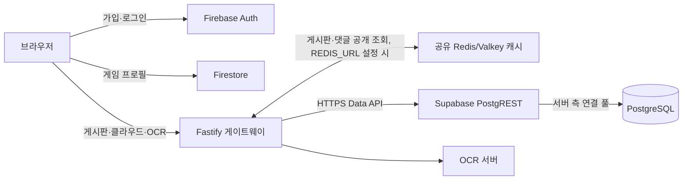
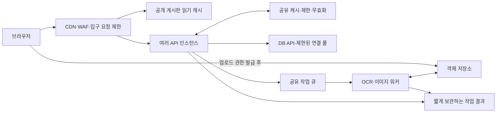

# 대규모 이용자를 위한 통신·요청 처리 설계

검토일: 2026-10-18. 아래 용량 수치는 계획용 가정이며, 운영 부하 테스트 결과가 아니다.

## 무엇을 기준으로 용량을 정할 것인가

가입자 1,000만 명, 일간 활성 사용자 1,000만 명, 동시 접속자 1,000만 명은 서로 다른 부하다. 다음 값을 기능별로 정해야 한다.

- DAU, 피크 동시 접속자, 사용자당 하루 API 요청 수, 피크 배율.
- OCR 요청 비율·평균/상위 지연·이미지 크기, 동기화 빈도와 전송 크기.
- 공개 조회 캐시 적중률, 인증 요청 비율, 사용자별 저장 충돌 정책.

예시로 사용자당 API 요청 30회/일, 피크가 일평균의 10배라고 가정하면:

| DAU | 평균 API 요청/초 | 가정한 피크 요청/초 |
| --- | ---: | ---: |
| 100만 | 약 347 | 약 3,472 |
| 1,000만 | 약 3,472 | 약 34,722 |

계산식은 `DAU × 일일 요청 수 ÷ 86,400`이다. 정적 파일, 재시도, 상태 확인 요청은 별도로 합산한다. API 한 번이 DB HTTP 요청 세 번을 만들면 캐시 이전 DB 요청률도 그만큼 늘어난다.

100만 DAU 중 10%가 하루 OCR 한 번을 요청하고 처리시간이 10초라면, 평균 약 1.16건/초와 12개의 처리 슬롯이 필요하다. 10배 피크를 처리하려면 약 116개의 슬롯이 필요하다. 실제 워커 수는 GPU/CPU별 처리량과 배치 효율을 측정해 결정한다. 이미지가 1 MB라면 업로드만 하루 약 100 GB이며, 게이트웨이에서 워커로 같은 이미지를 보내면 그 구간에도 같은 양의 전송이 생긴다. 사용자 수만 보고 서버 수를 정할 수는 없다.

## 현재 DB 접근 경로



게이트웨이는 `supabase-js`의 HTTP API를 사용한다. 브라우저마다 PostgreSQL 연결을 생성하는 구조가 아니다. PostgREST에는 자체 연결 풀이 있으므로 게이트웨이에 PgBouncer를 하나 더 붙인다고 현재 HTTP 왕복 횟수가 줄지는 않는다. 직접 SQL 연결로 전환한다면 전체 API 인스턴스의 풀 크기를 합산해 DB 연결 예산 안에서 설정해야 한다. [Supabase 연결 방식](https://supabase.com/docs/guides/database/connecting-to-postgres), [PostgREST 연결 풀](https://docs.postgrest.org/en/stable/references/connection_pool.html).

Firestore의 브라우저 접근은 인증과 Security Rules로 보호하는 공식 사용 방식이다. 중계서버를 추가하면 접근 제어·할당량·로깅을 모을 수 있지만, 네트워크 홉과 서버 비용도 생긴다. 이 저장소에는 배포된 Firestore 규칙이 없으므로 현재 규칙의 안전성을 확인한 것으로 간주하면 안 된다. 게임 프로필의 소유자별 접근과 필드 검증은 배포 규칙을 별도로 확인해야 한다. [Firebase 규칙 문서](https://firebase.google.com/docs/rules/basics).

## 이번 코드 변경

| 기능 | 변경 내용 | 범위와 한계 |
| --- | --- | --- |
| 요청 인증 | 같은 요청의 Firebase 토큰 검증과 사용자 조회를 공유. 일반 사용자 확인에서 멤버십 HTTP 조회 제거 | 권한·상태는 요청마다 조회. 장시간 권한 캐시를 추가하지 않음 |
| DB HTTP 통신 | 모든 Supabase HTTP 요청에 기본 10초 제한을 적용하고 호출자의 취소 신호도 유지 | `SUPABASE_HTTP_TIMEOUT_MS`로 조절. 연결 풀·DB 쿼리 제한을 대체하지 않음 |
| 로그인 사용자 동기화 | 사용자와 멤버십을 한 번에 조회. 변경이 없으면 최근 5분 내 `last_login_at` 쓰기 생략 | 로그인 시각은 최대 5분 단위 활동 기록. 정확한 로그인 감사 로그가 아님 |
| 동시 가입·초기화 | 사용자/멤버십 중복 생성 충돌 시 이미 생성된 행을 다시 읽음 | DB의 기존 유일 제약 필요. 인증 계정 생성은 Firebase 담당 |
| 통계용 사용자 식별 | 60초·최대 10,000개의 식별자 캐시. 통계 수집이 사용자/멤버십을 새로 만들지 않음 | 권한 판단에 사용하지 않음 |
| 클라우드 다운로드 | 로그인 직후 전체 자동 다운로드 제거. 기능을 열 때 요청하고 동일 다운로드는 공유. 단일 캐릭터는 DB에서도 해당 JSON 부분만 전송 | 부분 조회와 전체 조회의 캐시 범위를 구분하고 계정 변경 후 도착한 결과를 무시 |
| 클라우드 재조회 | 사용자·조회 범위·내용에 따른 ETag와 `private, no-cache`로 인증 후 304 응답 지원 | 브라우저 전송량 절약. DB 조회를 생략하는 캐시는 아님 |
| 단일 캐릭터 저장 | DB 함수 한 번으로 현재 JSON에 해당 캐릭터만 합침 | 다른 캐릭터의 동시 변경 유실 방지. 같은 캐릭터는 마지막 저장 우선. 전체 업로드는 전체 교체 |
| OCR | 단일/배치 OCR이 공유하는 업로드 입장 수 제한. 초과 시 503·Retry-After. 응답 본문 수신까지 실행 슬롯·시간 제한 유지 | 프로세스당 기본 실행 2개+대기/업로드 2개. 연결 종료 시 대기 작업은 upstream 호출을 생략 |
| 이벤트 로그 | 최대 100개씩 모아 저장. 대기 버퍼 1,000개, 동시 DB 전송 한 배치, DB 전송 제한 5초. 로그인 UI가 로그 전송을 기다리지 않음 | 비필수 통계용. 초과/실패 이벤트는 경고와 함께 버릴 수 있고 프로세스 종료에도 유실 가능 |
| 게시판 | `REDIS_URL` 설정 시 Redis/Valkey 공유 캐시 30–33초·서버 간 변경 무효화·동시 조회 통합. 작성자 조인 유지 | 장애 시 DB 우회. 분할 중 다른 서버는 TTL 내 오래된 값 가능. 설정 없으면 기존 10초 메모리 캐시 |
| CORS | preflight 캐시 최대 600초, 진단 헤더 노출 | API 데이터나 인증 결과를 공개 캐시하는 설정이 아님 |

Firebase ID 토큰 검증은 Admin SDK를 그대로 사용한다. 공개키 검증과 토큰 취소 여부 확인은 다른 작업이다. 토큰 검증을 제거하거나 브라우저가 보내는 사용자 ID를 신뢰해 DB 조회를 줄이지 않는다. [Firebase 토큰 검증](https://firebase.google.com/docs/auth/admin/verify-id-tokens).

## 배포 순서

1. 먼저 [character_data_atomic_sync.sql](sql/character_data_atomic_sync.sql)을 Supabase SQL editor에서 적용한다. 기존 `character_data.user_id` 유일 제약과 JSONB `data` 컬럼을 전제로 한다. 함수 실행 권한은 `service_role`에만 준다. 이 파일은 자동 실행되지 않는다. 아래 적용 기록의 WUWA dev 프로젝트에는 2026-10-18 적용했으며, 다른 환경에는 배포 전 별도 적용이 필요하다.
2. 스테이징에서 서로 다른 캐릭터 동시 저장, 2 MiB 총량 제한과 롤백, 기존 전체 저장을 확인한다. SQL 함수는 `ON CONFLICT DO UPDATE`의 원자적 갱신을 사용한다. [PostgreSQL 설명](https://www.postgresql.org/docs/current/sql-insert.html).
3. 게이트웨이와 프런트를 배포한다. SQL이 누락되면 단일 캐릭터 저장은 실패하며, 전체 데이터를 읽고 덮어쓰는 방식으로 자동 우회하지 않는다.
4. `OCR_CONCURRENCY`와 `OCR_MAX_PENDING`을 메모리/워커 처리량에 맞춰 설정한다. 기본값은 각각 2와 2. API 복제 수를 늘리면 이 한도도 인스턴스 수만큼 늘어난다.
5. 게시판 검색 인덱스는 별도 선택 사항인 [board_search_index.sql](sql/board_search_index.sql)로 적용한다.

## 여러 서버로 확장하기 전 필요한 구조



위 구성 중 게시판·댓글 공유 캐시는 구현했으며 [설정과 검증 절차](REDIS.md)에 따라 활성화한다. CDN API 캐시, 객체 업로드, 분산 작업 큐는 목표 설계다.

### 우선순위 1: 요청 증폭과 공개 읽기

- 게시판 목록/본문 같은 공개 읽기에 짧은 CDN 캐시와 공유 캐시를 둔다. 권한·개인 데이터·조회수 기록이 섞인 응답을 같은 캐시에 넣지 않는다. 현재 `view=1`은 DB 쓰기가 포함된 GET이므로 CDN 캐시 전에 조회수 기록을 별도 요청으로 분리해야 한다.
- 글/댓글 변경 시 관련 목록·본문·댓글 캐시의 공유 무효화를 구현했다. Redis와 DB의 원자적 커밋은 아니므로, 네트워크 분할 중 TTL보다 짧은 최신성을 보장하려면 내구성 있는 outbox 등 추가 구조가 필요하다.
- 깊은 목록의 OFFSET은 커서 페이지네이션으로 바꾸고, 댓글도 페이지 단위로 읽는다. 현재 댓글 API는 전체 댓글을 반환한다. 검색 시 정확한 전체 개수 계산도 비용을 측정한다.
- OCR health/wake는 여러 사용자가 같은 서버에 중복 호출하지 않도록 서버 측에서 묶는다. 현재 health는 언어별 upstream을 각각 호출한다.

### 우선순위 2: OCR을 긴 HTTP 연결에서 분리

- API는 짧게 만료되는 업로드 권한을 발급하고, 브라우저가 객체 저장소로 업로드한다. 파일 소유권·크기·실제 형식을 검증한 뒤 작업 ID를 만든다. 브라우저가 임의의 URL을 워커에 전달하게 하지 않는다.
- `202 + jobId`로 반환하고, 큐의 대기시간·GPU 사용률에 따라 워커를 늘린다. 결과는 SSE 또는 상한·지터·백오프를 둔 폴링으로 전달한다. 작업마다 HTTP 연결을 180초 유지하는 구조를 최종 구조로 삼지 않는다.
- 입력 해시와 모델 버전을 사용한 중복 작업 통합, 요청 재시도용 idempotency key, 작업 만료·취소·재시도 상한을 함께 설계한다. 개별 인스턴스의 `p-limit`만으로 전체 워커 용량을 제한할 수 없다.
- OCR 응답에 원본/미리보기 base64가 필요한지 기능별로 구분한다. 큰 이미지 결과는 객체 URL로 전달하고 보관 기간을 제한한다.

### 우선순위 3: 인증·쓰기·할당량

- 인증은 관리형 서비스에 두고, 사용자/계정별 요청 제한과 입구 IP 제한을 함께 적용한다. 지금의 프로세스별 30회/분 제한은 공유 제한이 아니며, NAT 사용자는 IP를 공유한다.
- 현재 `getClientKey`는 전달받은 `X-Forwarded-For`를 사용한다. 프록시 경로와 신뢰할 홉을 배포 환경에서 확인하고, 외부에서 위조한 헤더를 제한 키로 신뢰하지 않도록 정리해야 한다. IP 헤더 처리만 바꾸고 배포 프록시 설정을 확인하지 않으면 모든 이용자가 한 IP로 묶일 수 있다.
- 클라우드 데이터를 장기적으로 `(user_id, character_id)` 단위로 나누고 버전 충돌(ETag/If-Match 등)을 처리하면 같은 사용자 전체 JSON 행의 경합도 줄일 수 있다. 현재 원자적 병합은 전송과 변경 유실을 개선하지만 행 단위 직렬화는 남는다.
- 가입/로그인 통계는 내구성이 필요한 감사 로그와 구분한다. 감사·결제·사용량 차감은 메모리 통계 버퍼가 아닌 내구성 있는 큐/트랜잭션으로 처리한다.

## 검증과 확장 판단

기능별 RPS, p50/p95/p99, 429/503/5xx 비율, 요청·응답 바이트, DB HTTP 호출 수와 대기시간, 공개 캐시 적중률, OCR 대기시간/처리시간/슬롯 사용률, 메모리, 로그 유실 수를 수집한다. API 인스턴스 수만 늘려 DB/단일 OCR upstream으로 부하를 밀어 넣지 않는다.

부하 시험은 스테이징에서 조회 위주 혼합 트래픽 → 로그인/동기화 혼합 → OCR 워커 용량과 대기열 → 장애·복구 순으로 수행한다. 피크를 단계적으로 올리고 포화 시 정상 요청의 지연이 무한히 늘지 않는지 확인한다. 운영 DB/실제 GPU에 수천 건을 보내는 시험은 이번 작업에서 수행하지 않았다.

검증 명령:

```text
backend/gateway: npm run test:traffic
backend/gateway: npm run test:board
backend/gateway: npm run test:redis
backend/gateway: npx tsc --noEmit
frontend: npm run test:cloud
frontend: npm run build
```

자동화된 DB/auth 경로 테스트는 네트워크를 모의 처리한다. 실제 DB에서도 아래와 같이 권한·병합·롤백 검증을 수행했다. 서로 다른 연결을 이용한 동시 실행 부하 시험은 수행하지 않았다. 전체 프런트 타입 검사에는 기준 소스에서도 발생하는 오류 30개가 있으며, 이번 변경 전후 진단 비교에서 추가 오류는 없었다.


## Supabase 적용 기록 — 2026-10-18

- 대상: `WUWA dev` / project ref `gztvnkuyvwaekvboazql`, 로컬 게이트웨이의 Supabase URL과 일치함을 확인.
- Supabase 대시보드 SQL Editor에서 `character_data_atomic_sync.sql`과 `board_search_index.sql` 적용 완료. 직접 SQL 실행이며 Supabase CLI migration history 등록은 별도 작업이다.
- `merge_character_cloud_data(uuid,text,jsonb)`는 `SECURITY INVOKER`, 빈 search_path. `service_role` 실행 가능, `PUBLIC`·`anon`·`authenticated` 실행 권한 제거.
- 기존 `character_data.user_id` UUID 기본키, JSONB 데이터, service-role 테이블 권한을 확인. 기존 `character_data`·`board_posts` RLS 유지.
- `extensions` 스키마에 `pg_trgm` 1.6 설치. 공개 글만 포함하는 `board_posts_public_title_trgm_idx` GIN 인덱스가 유효함을 확인. 적용 당시 게시판은 9개 행이었다.
- 실제 `service_role`로 부분 병합, 다른 키 보존, 같은 키 갱신, 잘못된 JSON 입력 거부, 2 MiB 초과 거부와 해당 변경 롤백을 검증. 테스트 쓰기는 서브트랜잭션에서 모두 롤백하고 기존 데이터와 갱신 시각이 복원됐음을 확인했다.
- 게이트웨이용 Data API 경로에서도 새 RPC를 호출해 잘못된 입력을 `22023`으로 거부하는 것을 확인했다. 검증 호출은 쓰기 전에 거부되므로 사용자 데이터를 변경하지 않는다.
- [verify_scaling_changes.sql](sql/verify_scaling_changes.sql)에 재실행 가능한 읽기 전용 카탈로그 검사를 추가했다.
- Advisor Center도 확인했다. 기존 `refresh_board_post_comment_count()`의 anon/authenticated 실행 권한 경고와 기존 테이블의 GraphQL 스키마 노출 경고가 표시됐다. 이번에 추가한 함수의 실행 권한은 별도로 차단·검증했으며, 기존 객체의 권한이나 GraphQL 설정을 이번 적용에서 변경하지 않았다. 프로젝트 전체 보안 진단이 모두 통과한 것으로 간주하지 않는다.
- 이번 적용은 DB 변경이다. 로컬 게이트웨이·프런트의 최적화 코드를 운영 서버에 배포한 것은 아니다.

## 게시판 공유 캐시 적용 기록 — 2026-10-18

- Aiven `wuwa-dev / valkey-3cd46ba4`: Free-1(1 CPU, 1 GB), Valkey 9.1.2, DigitalOcean Bangalore, Running 확인. 캐시 전용 `allkeys-lfu` 정책 적용.
- 로컬 게이트웨이의 Git 제외 `.env`에 TLS 연결을 설정했다. 인증서 검증을 유지한 실제 서비스 테스트와 운영 Redis 어댑터 테스트가 통과했다. 테스트는 격리된 무작위 네임스페이스를 사용하고 생성한 키만 정리했다.
- 캐시 적중은 Redis 왕복 1회, 미적중은 DB 외 Redis 왕복 2회다. 로컬 PC → Aiven 적중 표본은 229 ms였다. 이전 프로세스 메모리 캐시의 1 ms 표본과는 조건이 다르며, 운영 게이트웨이의 지연 개선을 검증한 결과가 아니다.
- 공유 적중, 대상별 무효화, 쓰기 중 오래된 조회 차단, 동시 조회 통합, DB 오류 전달, Redis 장애·복구, 복구 중 재무효화, TTL, 큰 응답 우회, 잠금 만료/소유권, 환경 분리를 실제 Lua/TLS 경로에서 검증했다. 변경이 계속되는 목록은 제한된 재시도 후 DB 우회한다.
- 실제 Supabase 공개 데이터를 두 Fastify 앱에서 읽어 목록·본문·댓글이 두 번째 앱에서 Redis에 적중하는 것도 확인했다. 조회수나 사용자 데이터는 변경하지 않았다.
- 기존 Railway `WuwaDev-gateway / wuthering`의 production 환경에 `REDIS_URL`을 설정하고 적용했다. 서버 위치는 US East다. 로컬 `.env`에는 별도 `wuwa-local` 네임스페이스를 설정해 운영 캐시와 분리했다. 새 DB 마이그레이션은 없으며 이번 게이트웨이 코드 배포가 필요하다. [상세 설정](REDIS.md).
